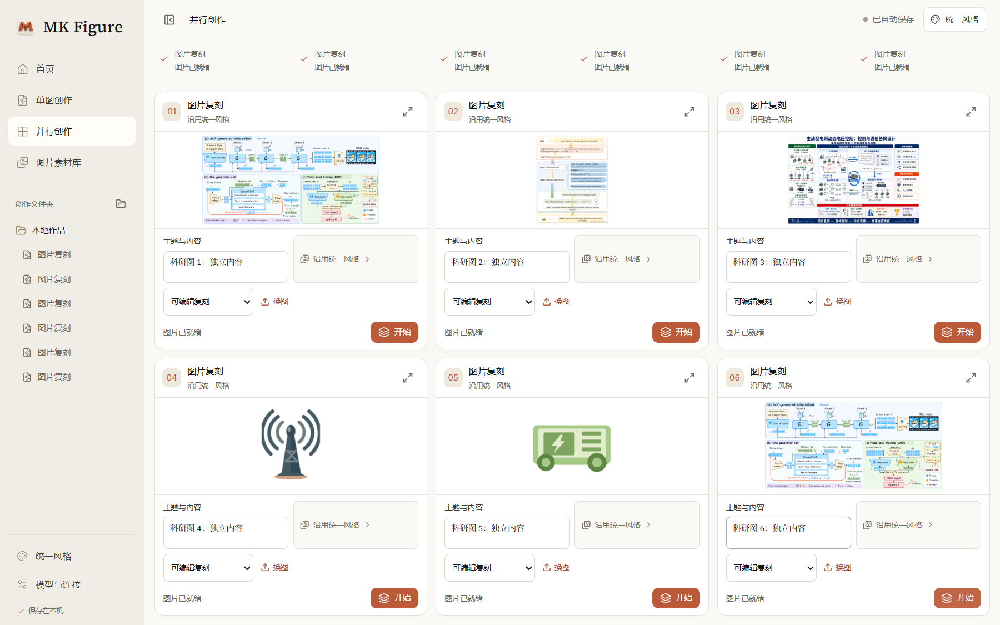
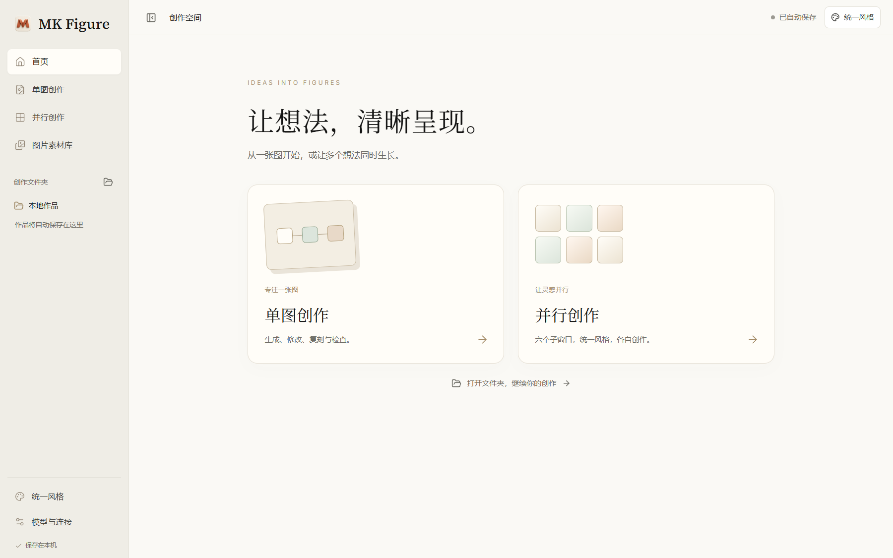
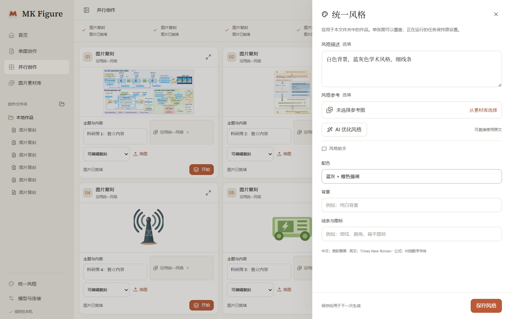
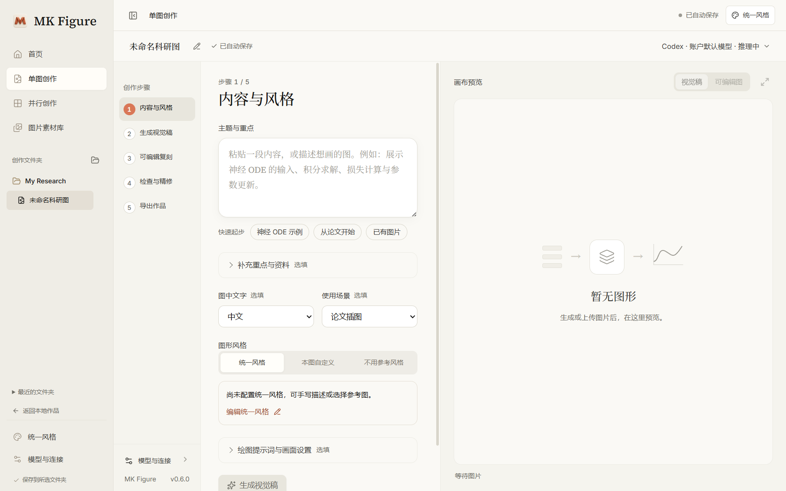
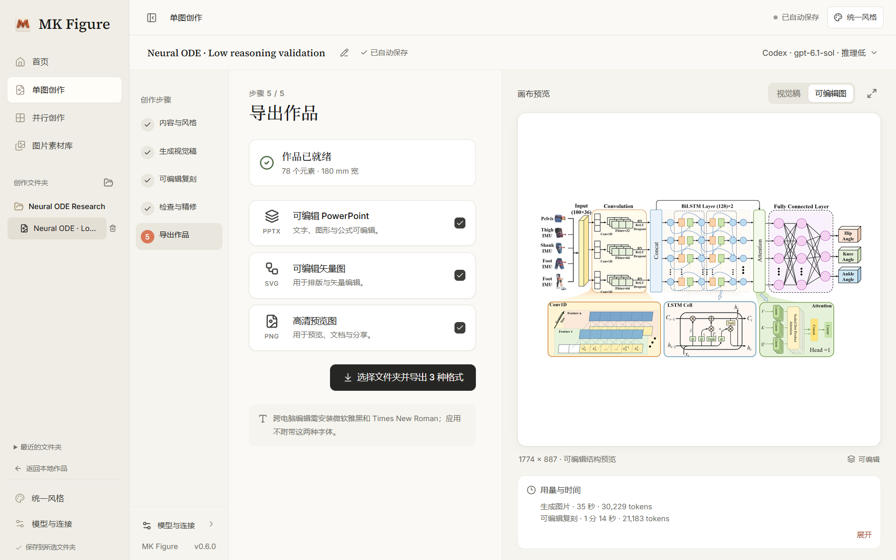

<div align="center">
  

  <h1>MK Figure · 科研绘图工作台</h1>

  <p><strong>从研究想法，到可以继续编辑的科研图。</strong></p>
  <p>Create, refine, and reconstruct scientific figures as editable PowerPoint and SVG.</p>

  <p>
    <a href="https://github.com/Layman-art/MKfigure/releases/latest"></a>
    
    
    <a href="LICENSE"></a>
  </p>

  <p>
    <a href="https://github.com/Layman-art/MKfigure/releases/latest"><strong>下载桌面版</strong></a> ·
    <a href="mk-figure-skill/"><strong>安装 Codex Skill</strong></a> ·
    <a href="icon-pack/"><strong>获取 SVG 图标</strong></a>
  </p>

  <p>
    <a href="#为什么用-mk-figure">为什么用 MK Figure</a> ·
    <a href="#功能一览">功能一览</a> ·
    <a href="#界面预览">界面预览</a> ·
    <a href="#快速开始">快速开始</a> ·
    <a href="#本地开发">参与开发</a>
  </p>
</div>

<p align="center">
  
  <br><sub>一个工作台，六张独立画布。截图为 0.6.0 参考素材载入演示。</sub>
</p>

> **Windows 最新版：v0.6.2**，包含六窗创作、统一风格和文件夹工作区，沿用原来的浅色界面。[下载安装包](https://github.com/Layman-art/MKfigure/releases/tag/v0.6.2) · [更新与验证记录](docs/release-0.6.2.md)。macOS 安装包仍为 v0.4.1，尚未同步这些新功能。

## 为什么用 MK Figure？

科研绘图往往还需要在生成后改字、改公式、统一配色，并保留下一次修改所需的资料。MK Figure 把这些环节组织成可继续的作品：从一段文字开始，也能直接上传现成图片进入复刻。

| 绘图中的反复操作 | MK Figure 提供的支持 |
| --- | --- |
| 图已生成，修改标签、公式和布局仍要重新制作 | **可编辑交付**：重建文字与矢量图形，导出 PPTX、SVG 和 PNG。 |
| 多张图逐一处理，参考风格与进度来回切换 | **六图并行**：同一窗口管理六张图，共用风格、独立执行，也可逐图覆盖。 |
| 提示词、原图与修改结果散在多次对话和文件中 | **作品持续保存**：按文件夹保留资料、版本、检查记录和用量，随时接着修改。 |

生成、修改、复刻和检查沿用 Codex 的模型能力；工作台负责衔接流程、组织文件和展示结果。实际质量与耗时仍取决于图的复杂度、模型及账户可用额度。

## 功能一览

### ✦ 从内容开始，也能从图片开始

- 输入主题或粘贴一段文字，即可开始绘图；论文资料、参考图、语言和用途均可选填。
- 直接手写提示词与风格，或按需使用 AI 整理和风格助手。
- 已有图片可跳过生图，直接复刻；不满意时继续改图或重新生成，并保留图片版本。

### ◫ 单图专注，六图并行

- 单图与并行创作分别进入；六张图各自开始、停止和查看进度。
- 统一风格可复用描述、配色与参考图；每张图也可自定义或不使用参考风格。
- 展开一张图时，其他任务继续运行。实际并发受云端排队与账户限流影响。

### ⌘ 检查、精修与可编辑导出

- 文字、形状与曲线重建为可编辑对象，公式使用衬线文字与线条，不使用 Office Math。
- 提供结构检查、视觉与内容核对、文字修改和按意见精修。
- 按需导出 PPTX / SVG / PNG；**只选 PPTX，就只导出一个 PPTX 文件**。

### ▤ 资料和过程留在作品里

- 文件夹侧栏保存并继续创作；素材库统一管理参考图与个人图标。
- 可记住多个文件夹，重启恢复上次活动目录；“从侧栏移除”只移除入口，本地文件保留，重新打开即可继续。
- 内置 3 张参考图与 10 个 SVG 图标，可导入自己的素材。
- 展示任务耗时、模型、推理强度及模型回传的 Token 用量；Token 不是账户余额或费用。

## 界面预览

<table>
  <tr>
    <td width="50%" align="center">
      
      <br><sub>单图与并行：按当前任务选择创作方式</sub>
    </td>
    <td width="50%" align="center">
      
      <br><sub>统一风格：公共规范复用，单张图可覆盖</sub>
    </td>
  </tr>
  <tr>
    <td width="50%" align="center">
      
      <br><sub>文件夹工作区：资料与创作过程一起保留</sub>
    </td>
    <td width="50%" align="center">
      
      <br><sub>导出界面：CNN–BiLSTM–Attention 网络展示</sub>
    </td>
  </tr>
</table>

界面截图来自 0.6.0 Windows 程序。右下图为展示合成图，仅将原截图画布中的科研图替换为用户提供的下肢关节角度估计网络复刻图（CNN–BiLSTM–Attention），保留其余界面；其中项目名称、元素数量及运行数据仍属于原 Neural ODE 示例。真实生成、复刻、导出及 PowerPoint 编辑验证范围见[验证记录](docs/validation-0.6.0.md)。

## 快速开始

### 让 Codex 帮你安装

在 Codex 中复制下面任意一条指令，即可选择只安装 Skill，或将 Skill 与桌面平台一起安装。这里的 **Skill 是 `mk-figure-skill`**，用于在 Codex 对话中完成科研图生成、修改、可编辑 PPTX/SVG 复刻与检查；它已合并原 `ppt-editable` 的复刻与局部修复方法，无需另装 `ppt-editable`。**桌面平台**是独立的 MK Figure 软件。

**只安装 Skill**

```text
请从 https://github.com/Layman-art/MKfigure 安装 mk-figure-skill 目录到我的 Codex skills 目录。只安装 Skill，不安装桌面软件；已有同名版本先备份。安装后检查文件完整性，并告诉我如何开始使用。
```

**Skill + 桌面平台一起安装**

```text
请帮我一站式安装 MK Figure 桌面软件和 Codex Skill：https://github.com/Layman-art/MKfigure 。检测系统和处理器架构，从 GitHub Releases 下载适配的最新可用桌面安装包，核对校验和后安装；同时将仓库中的 mk-figure-skill 目录安装到 Codex skills 目录。已有 Skill 先备份，保留已有作品和设置。完成后分别检查安装结果，并给我一条可直接使用的绘图指令。
```

Codex 可协助下载、安装与检查；系统权限确认、安装向导或账户登录需要时由你完成。桌面包按平台选择，Windows 与 macOS 的最新可用版本可能不同；不要将 GitHub 的 Source code 压缩包当作安装程序。

### 手动安装与开始创作

1. Windows 下载 [v0.6.2 安装包](https://github.com/Layman-art/MKfigure/releases/tag/v0.6.2) 并运行安装程序；macOS 暂用 [v0.4.1](https://github.com/Layman-art/MKfigure/releases/tag/v0.4.1)，解压 ZIP 后将应用拖入“应用程序”。
2. 打开 **模型与连接**，登录 Codex 或检测已有登录，选择账户支持的模型与推理强度。
3. 点击“打开文件夹”选择创作目录，再输入主题、粘贴资料或上传已有图片，选择参考风格；无需先让 AI 改写提示词。
4. 生成或复刻后核对文字、公式和箭头，按需精修，再导出需要的格式。

| 使用方式 | 入口 |
| --- | --- |
| Windows x64 | [v0.6.2 安装包](https://github.com/Layman-art/MKfigure/releases/tag/v0.6.2) · [用户指南](docs/user-guide.md) |
| macOS 13+（Apple Silicon、Intel） | [v0.4.1 历史安装包](https://github.com/Layman-art/MKfigure/releases/tag/v0.4.1) · [v0.4.1 安装指南](安装与使用.md) |
| 在 Codex 对话中使用流程 | [mk-figure-skill](mk-figure-skill/)：将目录安装到本机 Codex skills 目录，已有同名版本先备份。 |
| 单独使用矢量素材 | [10 个 SVG 图标](icon-pack/) |
| 从源码运行 | [本地开发](#本地开发) · [工作区使用指南](docs/user-guide.md#管理作品) |

安装包包含运行时，不要求用户另装 Node.js、Python 或 PowerPoint；在 PowerPoint 中编辑 PPTX 时需安装相应软件。当前只接入 Codex，生图能力与可选模型以账户实际支持为准。

## 数据与使用边界

作品保存在本机；文件夹作品位于所选目录的 `.mkfigure/` 中。**执行模型任务时，会按任务需要将内容、资料和参考图发送给 Codex**。软件不提供云同步；备份文件夹作品时需保留整个目录，包括 `.mkfigure/`。完整流向见[数据流说明](docs/data-flow.md)。

<details>
<summary><strong>查看字体、检查与平台说明</strong></summary>

- 中文默认微软雅黑，英文为 Times New Roman；字体不随软件分发，跨电脑编辑需自行安装。复杂公式改字后可能需要手动调整间距。
- 结构检查通过不代表科学内容正确或逐像素还原。复杂图、公式、箭头和论文结论仍需人工核对；PDF/PPTX 导入主要提取文字。
- 六路并发通过本地可控模型测试；真实云端全流程验证覆盖一张简洁示例图，不能据此承诺六倍提速或所有复杂图都能通过。
- Windows 安装包尚未做发行者代码签名。macOS 包已做结构校验，尚未完成 Mac 真机验证、Developer ID 签名或 Apple 公证。

</details>

## 文档导航

| 我想了解 | 文档 |
| --- | --- |
| 生成、改图、复刻、导出与素材管理 | [完整使用指南](docs/user-guide.md) |
| 六窗、文件夹保存与统一风格 | [0.6.0 创作工作区](docs/workspaces-0.6.0.md) |
| 已测内容、未测内容及 PowerPoint 验证 | [0.6.0 验证记录](docs/validation-0.6.0.md) |
| 软件、Codex 与 skill 如何衔接 | [数据流与代码入口](docs/data-flow.md) |

## 本地开发

技术栈：Electron · React · TypeScript · Vite · Vitest · Playwright。需要 Node.js 22+ 和 npm。

```sh
git clone https://github.com/Layman-art/MKfigure.git
cd MKfigure
npm ci
node scripts/prepare-codex.mjs
node scripts/prepare-library-assets.mjs
npm run dev
```

检查与打包：

```sh
npm test
npm run build
npm run dist:win
# 在 macOS 上构建
npm run dist:mac
```

默认测试不调用真实模型；显式开启在线验证会使用账户额度。Mac 构建细节见[打包说明](docs/mac-package-validation.md)。欢迎通过 [Issues](https://github.com/Layman-art/MKfigure/issues) 反馈问题，或提交 Pull Request。

## 开源与来源

桌面软件、[Codex skill](mk-figure-skill/) 与 [SVG 图标包](icon-pack/) 同仓维护，采用 [MIT License](LICENSE)。原 PPT-editable 的工具与方法已合并，来源与许可见[合并说明](docs/ppt-editable-integration.md)；参考素材来源见[素材记录](resources/library/provenance.md)。

仓库首页的展示结构参考 [Research Workbench](https://github.com/Layman-art/Research-Workbench)。
